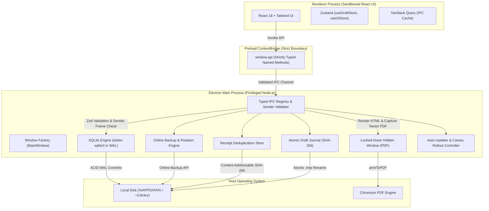

<!-- path: README.md -->
# Invoice Studio (`invoice-studio`)

> **Offline-first native desktop invoicing and expense management for Kenyan freelancers and small businesses with unreliable connectivity. Engineered to never lose data.**

[](https://github.com/crnjis/invoice-studio/actions/workflows/ci.yml)
[](https://github.com/crnjis/invoice-studio/actions/workflows/release.yml)
[](LICENSE)
[](docs/code-signing.md)
[-emerald.svg)](#kenyan-market-tailoring)

---

## 1. What & Why

Freelancers and software consultants working in Nairobi and throughout Kenya face frequent power cuts, intermittent mobile data hotspot tethering, and unreliable broadband. Cloud-only SaaS invoicing tools risk dropping unsaved edits during sudden disconnections, leaking sensitive client financial records, or holding user data hostage behind monthly subscription paywalls.

**Invoice Studio** is a hardened, offline-first desktop suite that operates with **zero cloud dependencies**. Your entire ledger lives locally in an ACID-compliant SQLite database, performs minor-unit accounting in Kenyan Shillings (KES), generates high-definition vector PDFs directly with Chromium's print engine, and safeguards every draft with atomic crash-safe write journals.

---

## 2. Architecture Overview



---

## 3. UI Screenshot & Layout Breakdown

```
+----------------------------------------------------------------------------------+
|  [IS] Invoice Studio      [Sandboxed Native]    v0.1.0 (win32)     [Dark Mode]   |
+----------------------------------------------------------------------------------+
|  [ + New Invoice (Ctrl+N) ]   [ + Add Client ]   [ + Expense ]   [ Backups ]      |
+----------------------------------------------------------------------------------+
|  FINANCIAL SUMMARY (JAN - MAR 2026)                                              |
|  Total Invoiced: KES 450,000.00  |  Revenue: KES 320,000.00  | Outstanding: ...  |
+----------------------------------------------------------------------------------+
|  INVOICES                      | ACTIVE INVOICE EDITOR                           |
|  [Search invoices...]          | Number: INV-2026-0042        Status: Draft      |
|  - INV-2026-0042 (Draft)       | Client: Nairobi Silicon Savannah Ltd            |
|  - INV-2026-0041 (Paid, M-Pesa)| Issue: 2026-03-01   Due: 2026-03-31   Curr: KES  |
|  - INV-2026-0040 (Overdue)     | ----------------------------------------------- |
|                                | Item: Cloud Migration & API Integration         |
|                                | Qty: 1   Rate: KES 100,000.00   VAT: 16%        |
|                                | Subtotal: KES 100,000.00  Tax: KES 16,000.00    |
|                                | Total: KES 116,000.00                           |
|                                | [ Export PDF ]  [ M-Pesa Record ]  [ Save ]     |
+----------------------------------------------------------------------------------+
|  Status: Offline Mode (Working Locally) | SQLite WAL Active | Zero Cloud Lockout |
+----------------------------------------------------------------------------------+
```

---

## 4. Core Features

### Kenyan Market Tailoring
- **Currency**: Kenyan Shilling (`KES`) default with integer minor-unit arithmetic (cents) preventing floating-point rounding errors.
- **Taxation**: 16% Value Added Tax (VAT) configurable default rate per line item.
- **Payment Reconciliation**: Native fields for Safaricom M-Pesa transactions (Paybill, Till Number, M-Pesa receipt code e.g. `QHD4561239`), bank accounts, and cash.
- **Phone & Tax PIN Validation**: Validates Kenyan mobile numbers (`+2547XXXXXXXX`, `+2541XXXXXXXX`, `07...`) and Kenya Revenue Authority PINs (`P051234567A`).

### Accounting & Invoicing
- **Gap-Free Numbering**: Sequential annual invoice numbers (`INV-YYYY-XXXX`) generated inside atomic database transactions.
- **Invoice Lifecycle**: Full tracking of `draft`, `sent`, `partially_paid`, `paid`, `overdue`, and `void` statuses.
- **Automated Overdue Detection**: Background and on-startup evaluation of past-due invoices with payment reminder flags.
- **Duplication & Templates**: One-click invoice cloning for recurring monthly retainers.

### PDF Invoicing Engine
- **3 Built-in Professional Templates**:
  - `Classic`: Formal corporate table layout with bordered breakdown.
  - `Modern`: Gradient header banner with prominent M-Pesa settlement card.
  - `Minimal`: Clean Swiss architectural typography with hairline dividers.
- **Vector Quality**: Generated via Chromium's headless `webContents.printToPDF` with exact `@page` print style formatting.
- **One-Click Sharing**: Direct save, reveal in OS file explorer, or prepare email via honest `mailto:` generator.

### Receipts & Expense Tracking
- **Content-Addressable Storage**: Attached receipt images (JPEG, PNG, WebP) and PDFs are stored in `<userData>/receipts/` hashed by their SHA-256 checksums, guaranteeing automatic deduplication.
- **Categorization**: Track expenses across `software`, `equipment`, `travel`, `office`, `marketing`, `subcontractor`, and `utilities`.

### Zero-Loss Disaster Recovery & Backups
- **SQLite WAL Mode**: Continuous Write-Ahead Logging prevents database corruption on abrupt power termination.
- **Online Backup API**: Consistent point-in-time database snapshots created while the app is running.
- **Cloud-Folder Sync**: Set your backup directory to Dropbox, Google Drive, or OneDrive for automated off-site safety.
- **Rotation Policy**: Automatically keeps 7 daily and 4 weekly snapshots.
- **One-Click Restore**: Restore with integrity preview and an automated pre-restore rollback snapshot.
- **Crash-Safe Unsaved Draft Recovery**: Atomic `.tmp` file journals preserve active invoice edits during unexpected shutdowns.

### Auto-Update & Staged Canary Rollouts
- **Bandwidth Safety**: `autoDownload = false` ensures updates never download on metered data without user approval.
- **Staged Rollouts**: Deterministic client hashing supports progressive canary rollouts (10% $\to$ 25% $\to$ 50% $\to$ 100%) via `stagingPercentage`.
- **Pre-Update Snapshot**: Mandatory SQLite database backup executed immediately before installing an update.

---

## 5. Non-Negotiable Security Baseline

| Measure | Implementation Details |
| :--- | :--- |
| **Process Isolation** | `contextIsolation: true`, `sandbox: true`, `nodeIntegration: false`. |
| **Preload Boundary** | Narrow named ContextBridge methods; raw `ipcRenderer` is never exposed to the DOM. |
| **IPC Sender Validation** | Every handler validates `event.senderFrame` origin and rejects nested iframes. |
| **Input Validation** | All incoming IPC arguments validated with strict Zod schemas. |
| **External URL Guard** | URL scheme allowlist (`https:`, `mailto:`) prevents arbitrary protocol execution. |
| **Electron Fuses** | Disabled `RunAsNode`, enabled cookie encryption, and enforced `OnlyLoadAppFromAsar`. |
| **Content Security Policy** | Strict CSP: `default-src 'self'; script-src 'self'; object-src 'none'; frame-ancestors 'none';`. |

---

## 6. Honest Scope Boundary: Kenya KRA eTIMS

> [!IMPORTANT]
> **Statutory Tax Scope Disclaimer**:
> Kenya's Kenya Revenue Authority (KRA) enforces electronic tax invoicing regulations under **eTIMS** (electronic Tax Invoice Management System). **Invoice Studio does NOT claim statutory KRA eTIMS compliance and does not transmit fiscal data directly to KRA servers.**
> It is designed as an internal operational ledger, invoicing generator, and expense tracker for freelancers and small businesses. If you require statutory eTIMS fiscalization, consult a licensed KRA tax agent or utilize the official KRA eTIMS portal alongside this tool.

---

## 7. Tech Stack

| Component | Technology | Version | Architectural Rationale |
| :--- | :--- | :--- | :--- |
| **Shell** | Electron | `31.2.0` | Native cross-platform desktop runtime with Chromium sandbox |
| **Frontend** | React + Vite | `18.3.1` / `5.3.4` | Component UI with `electron-vite` fast HMR build tooling |
| **Styling** | Tailwind CSS | `3.4.6` | High-contrast accessible dark theme and print styling |
| **Database** | `better-sqlite3` | `11.1.2` | Fast synchronous C++ SQLite driver with WAL mode and Online Backup API |
| **Validation** | Zod | `3.23.8` | Schema validation on all IPC payloads and domain inputs |
| **State** | Zustand | `4.5.4` | Lightweight reactive state with localStorage and draft autosave |
| **PDF** | Chromium `printToPDF` | Built-in | Pixel-perfect vector PDF rendering without external heavy binaries |
| **Packaging** | `electron-builder` | `24.13.3` | Multi-platform installers (Windows NSIS, macOS DMG, Linux AppImage) |
| **Testing** | Vitest + Playwright | `1.6.0` / `1.45.3` | Unit, scale (10k), and Electron GUI E2E testing |

---

## 8. Quick Start

### Prerequisites
- Node.js `20.x` LTS
- npm `10.x` or higher
- C++ build tools (for native `better-sqlite3` compilation)

### Installation & Development
```bash
# Clone the repository
git clone https://github.com/crnjis/invoice-studio.git
cd invoice-studio

# Install dependencies and build native SQLite module for Electron ABI
npm install

# Start development app with Hot Module Replacement (HMR)
npm run dev
```

### Production Build & Packaging
```bash
# Compile TypeScript and bundle with Vite
npm run build

# Package platform-specific installers
npm run package:win       # Windows NSIS Setup (.exe)
npm run package:mac       # macOS DMG & Zip (.dmg, .zip)
npm run package:linux     # Linux AppImage & Debian (.AppImage, .deb)
```

---

## 9. Testing & Quality Verification

Invoice Studio features automated unit, integration, scale, accessibility, and E2E test suites:

```bash
# 1. Typecheck across Node and Web configurations
npm run typecheck

# 2. Run ESLint code quality analysis
npm run lint

# 3. Run all unit and integration tests (23 suites, 90 tests)
npm test

# 4. Run the 10,000 Invoices Scale & Performance Benchmark
npm run test:perf

# 5. Run Playwright Electron End-to-End GUI Test
npm run test:e2e
```

---

## 10. Roadmap

- [x] Phase 0: Scaffold, hardened window factory, CSP & Electron Fuses.
- [x] Phase 1: Typed IPC registry, sender validation & error serialization.
- [x] Phase 2: SQLite in WAL mode, integer minor-unit money arithmetic & migrations.
- [x] Phase 3: Online SQLite backup API, rotation policy & one-click restore.
- [x] Phase 4: Client and invoice state management, window state restore, native menus & tray.
- [x] Phase 5: Headless HTML/CSS PDF templates (Classic, Modern, Minimal) & honest `mailto:`.
- [x] Phase 6: Expenses with SHA-256 receipts, partial payment tracking & RFC 4180 CSV export.
- [x] Phase 7: Offline-first network degradation & crash-safe atomic draft recovery.
- [x] Phase 8: Auto-updates with staged rollouts & SemVer downgrade protection.
- [x] Phase 9: Electron Builder configurations & GitHub Actions release matrix.
- [x] Phase 10: Playwright Electron E2E workflow & 10k invoices performance benchmark.
- [x] Phase 11: Production documentation, ADRs & user data safety guide.
- [ ] Future: Optional Safaricom Daraja STK Push sandbox integration.

---

## 11. License

MIT License. Copyright &copy; 2026 Chris (Nairobi, Kenya). All rights reserved. See [`LICENSE`](LICENSE) for terms.

