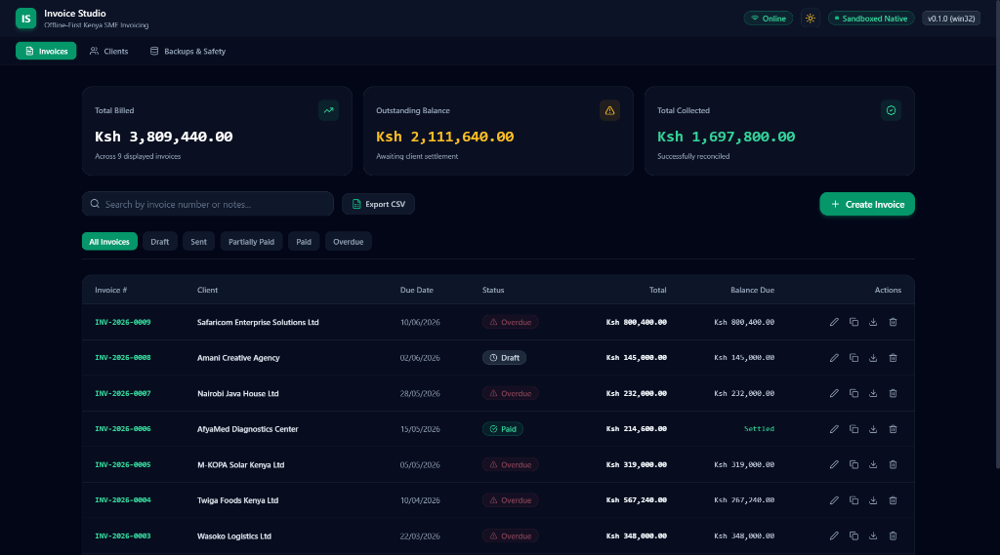
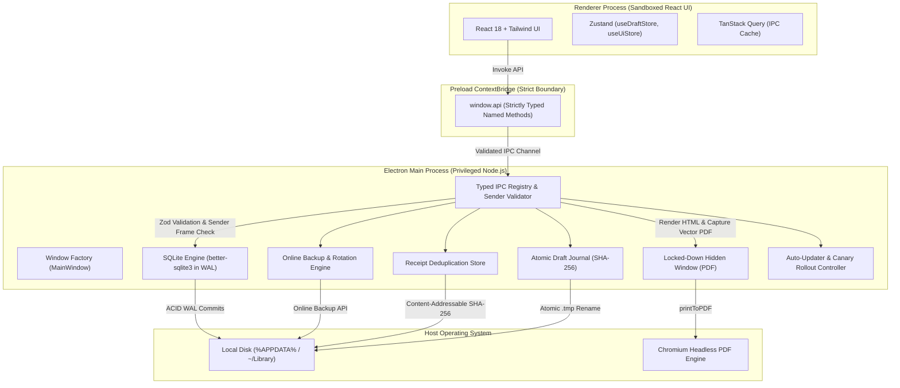

<!-- path: README.md -->
# Invoice Studio (`invoice-studio`)

> **Hardened, offline-first native desktop invoicing and financial management suite for Kenyan freelancers, consultants, and SMEs with unreliable connectivity. Engineered to never lose data.**

[](https://github.com/crnjis/invoice-studio/actions/workflows/ci.yml)
[](https://github.com/crnjis/invoice-studio/actions/workflows/release.yml)
[](LICENSE)
[](docs/code-signing.md)
[-emerald.svg)](#kenyan-market-tailoring)
[-success.svg)](#9-testing--quality-verification)

---

## 📸 Application Preview



*Figure 1: Invoice Studio running in dark mode on Windows 11 with live financial pulse cards, sequential Kenyan SME invoices, multi-status filters, and instant CSV accounting exports.*

---

## 1. What & Why

Freelancers and engineering consultants working in Nairobi and throughout Kenya frequently experience power blackouts, erratic broadband, and unstable mobile hotspot tethering. Cloud-only SaaS invoicing platforms risk dropping unsaved edits during unexpected disconnections, leaking sensitive client financial records, or locking users out behind recurring dollar-denominated subscription paywalls.

**Invoice Studio** is a hardened, offline-first desktop suite that operates with **zero cloud dependencies**. Your entire financial ledger lives locally in an ACID-compliant SQLite database, performs integer minor-unit accounting in Kenyan Shillings (KES), generates high-definition vector PDFs directly with Chromium's print engine, and safeguards every draft with atomic crash-safe write journals.

---

## 2. Architecture Overview



---

## 3. Core Features

### 🇰🇪 Kenyan Market Tailoring
- **KES Integer Arithmetic**: All monetary amounts are computed in integer minor units (cents) to completely eliminate floating-point rounding errors.
- **Kenyan Value Added Tax (VAT)**: 16% standard VAT calculations applied by default with editable line-item tax rate overrides.
- **Safaricom M-Pesa Settlement Rails**: Native tracking for M-Pesa Paybill numbers, Buy Goods Till numbers, mobile phone numbers, and official M-Pesa receipt confirmation references (e.g., `QBK8947K12`).
- **KRA PIN & Phone Validation**: Strict validation for Kenya Revenue Authority Personal Identification Numbers (`P051234567A`) and Kenyan mobile formats (`+2547...`, `+2541...`, `07...`, `01...`).
- **Honest Compliance Disclaimer**: Explicitly transparent disclaimer clarifying that automated KRA eTIMS transmission is out of scope and requires official KRA portals.

### 💼 Professional Invoicing & Clients
- **Transactional Gap-Free Numbering**: Sequential annual invoice identifiers (`INV-YYYY-XXXX`) generated inside atomic database transactions with automatic calendar year resets.
- **Invoice Lifecycle**: Full tracking across `draft`, `sent`, `partially_paid`, `paid`, `overdue`, and `void` statuses.
- **Automated Overdue Detection**: Background and on-startup evaluation of due dates marking past-due invoices with visual urgency banners.
- **Client Directory**: Centralized client records with tax PIN badges, billing addresses, and notes.
- **Fast Duplication**: One-click invoice cloning for recurring monthly retainers and project sprints.

### 📄 PDF Invoicing Engine
- **3 Built-in Professional Templates**:
  - `Classic`: Corporate layout with detailed financial breakdown tables and signature sections.
  - `Modern`: Contemporary design featuring bold brand accent colors and M-Pesa settlement cards.
  - `Minimal`: Clean Swiss architectural typography with hairline dividers.
- **Chromium Vector Rendering**: Generated via headless Chromium `webContents.printToPDF` with exact `@page` print rules.
- **Instant Actions**: One-click direct PDF export, OS folder reveal, and honest `mailto:` email dispatch.

### 🛡️ Zero-Loss Disaster Recovery & Backups
- **SQLite WAL Mode**: Continuous Write-Ahead Logging prevents database corruption during sudden power outages or forced shutdowns.
- **Non-Blocking Online Backups**: Creates hot database snapshots without locking tables or interrupting user workflows.
- **Automated Retention Rotation**: Automatically maintains 7 daily and 4 weekly backup archives.
- **Pre-Restore Rollback Snapshots**: Restoring any backup takes an immutable safety snapshot of the active database first.
- **Crash-Resilient Draft Autosave**: Active invoice drafts are continuously written to disk with SHA-256 integrity checksums. A recovery banner automatically appears if the app terminates abnormally.

### 📊 Financial Pulse & RFC 4180 CSV Reports
- **Real-Time Pulse Cards**: Instant calculations for Total Billed, Outstanding Balances, and Total Collected.
- **Spreadsheet Ready Exports**: One-click export of invoice records and categorized operating expenses to standard RFC 4180 CSV files.

---

## 4. Security Baseline

| Measure | Implementation Details |
| :--- | :--- |
| **Process Isolation** | `contextIsolation: true`, `sandbox: true`, `nodeIntegration: false`. |
| **Preload Boundary** | Narrow named ContextBridge methods; raw `ipcRenderer` is never exposed to the DOM. |
| **IPC Sender Validation** | Every handler validates `event.senderFrame` origin and rejects nested frames or unauthorized origins. |
| **Zod Schema Validation** | Every IPC input argument is validated against strict Zod runtime schemas before execution. |
| **External URL Guard** | URL scheme allowlist (`https:`, `http:`, `mailto:`) prevents arbitrary protocol execution. |
| **Electron Fuses** | Disabled `RunAsNode`, enabled cookie encryption, and enforced `OnlyLoadAppFromAsar`. |

---

## 5. Quickstart & Installation

### Prerequisites
- **Node.js**: v20+ LTS recommended
- **Operating System**: Windows 10/11, macOS (Intel & Apple Silicon), or Linux (Ubuntu, Debian, Fedora)

### Development Setup
```bash
# 1. Clone repository
git clone https://github.com/crnjis/invoice-studio.git
cd invoice-studio

# 2. Install dependencies (auto-configures better-sqlite3 for Electron)
npm install

# 3. Launch application in development mode
npm run dev
```

### Production Launch
```bash
# Compile bundle and run native desktop GUI
npm run build
npm start
```
*(On Windows, you can also double-click `run.bat` in the project root)*

---

## 6. Database & CLI Tooling

```bash
# Seed realistic Kenyan demo data (8 clients, 9 invoices across Q1/Q2 2026, 8 expenses)
npm run seed

# Clear all database entries back to pristine production state
npm run db:clear
```

---

## 7. Packaging & Multi-Platform Releases

```bash
# Build production bundle
npm run build

# Package installers
npm run package:win       # Windows NSIS Setup (.exe) -> dist/
npm run package:mac       # macOS DMG & Zip (.dmg, .zip) -> dist/
npm run package:linux     # Linux AppImage & Debian (.AppImage, .deb) -> dist/

# Verify release assets and auto-update manifests
npm run verify:assets
```

---

## 8. Keyboard Shortcuts

| Shortcut | Action | Scope |
| :--- | :--- | :--- |
| `Ctrl+N` / `Cmd+N` | Create New Invoice (opens Editor) | Global |
| `Ctrl+B` / `Cmd+B` | Open Backups & Safety Manager | Global |
| `Ctrl+Shift+I` | Toggle Developer Tools | Development |
| `Escape` | Close active modal dialog | Modal |

---

## 9. Testing & Quality Verification

Invoice Studio features automated unit, integration, scale, accessibility, and E2E test suites:

```bash
# 1. Typecheck across Node and Web configurations
npm run typecheck

# 2. Run ESLint code quality analysis
npm run lint

# 3. Run all unit test suites (23 suites, 98 tests)
npm test

# 4. Run the 10,000 Invoices Scale & Multi-Index Benchmark
npm run test:perf

# 5. Run Playwright Electron End-to-End GUI Test
npm run test:e2e
```

---

## 10. Project Structure

```text
invoice-studio/
├── .github/
│   └── workflows/          # CI/CD pipelines (test, build, multi-platform release)
├── build/                  # Packaging icons and entitlements
├── docs/
│   ├── adr/                # Architectural Decision Records (ADR 001 - 008)
│   ├── assets/             # Screenshots and diagrams
│   ├── architecture.md     # System design & IPC boundary specification
│   ├── code-signing.md     # Code signing & notarisation setup
│   └── data-safety-guide.md# Disaster recovery & zero data loss runbook
├── scripts/                # Launch, test, build, and database CLI scripts
├── src/
│   ├── main/               # Electron Main Process (SQLite WAL, IPC handlers, PDF)
│   ├── preload/            # Hardened ContextBridge preload scripts
│   ├── renderer/           # Sandboxed React 18 UI with Tailwind CSS
│   ├── shared/             # Shared TypeScript schemas, types, and money utils
│   └── tests/              # Unit, integration, scale, and E2E test suites
├── electron-builder.yml    # Multi-platform installer configuration
├── electron.vite.config.ts # Electron-Vite bundling configuration
└── package.json            # Scripts and dependency specifications
```

---

## 11. Architectural Decision Records (ADRs)

Key architectural choices are formally documented in the [`docs/adr/`](docs/adr/) directory:
- [ADR 001: SQLite with WAL Mode as Embedded Datastore](docs/adr/001-sqlite-wal-datastore.md)
- [ADR 002: Integer Minor-Unit Arithmetic for Currency Calculations](docs/adr/002-integer-minor-units-currency.md)
- [ADR 003: Headless Chromium PDF Generation Strategy](docs/adr/003-headless-chromium-pdf-generation.md)
- [ADR 004: Gap-Free Sequential Invoice Numbering](docs/adr/004-gap-free-invoice-numbering.md)
- [ADR 005: Sandboxed Preload and Strongly Typed IPC Boundary](docs/adr/005-sandboxed-ipc-bridge.md)
- [ADR 006: Crash-Safe Atomic Draft Storage](docs/adr/006-crash-safe-draft-storage.md)
- [ADR 007: Staged Canary Rollout Architecture](docs/adr/007-staged-canary-rollouts.md)
- [ADR 008: Content-Addressable Receipt Storage](docs/adr/008-content-addressable-receipts.md)

---

## 12. License & Author

**Invoice Studio** is open source software licensed under the [MIT License](LICENSE).

Developed with ❤️ for Kenyan software engineers, freelancers, and small businesses by **Chris** (Nairobi, Kenya).
