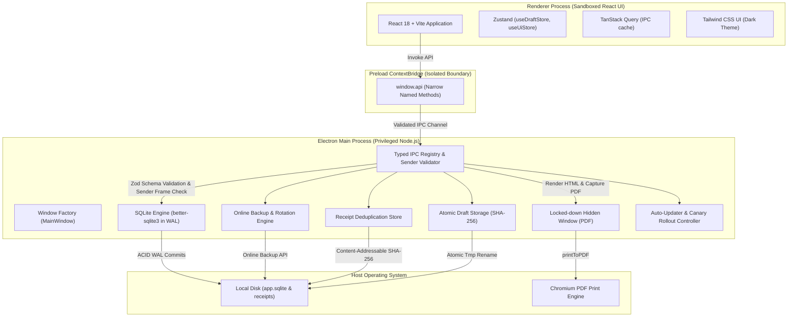

<!-- path: docs/architecture.md -->
# Invoice Studio: System Architecture

Invoice Studio is an offline-first desktop application engineered for Kenyan freelancers and SMEs. It guarantees data durability, process security, and fast local-first operation.

---

## 1. Process Model & Security Architecture

Invoice Studio strictly adheres to the **Electron Security Baseline**:
- `nodeIntegration: false` in all renderer windows.
- `contextIsolation: true` in all renderer windows.
- `sandbox: true` enforced on all web contents.
- Strict Content Security Policy (CSP) blocking external scripts, objects, and framing.
- Electron Fuses configured to disable `RunAsNode`, enable cookie encryption, and enforce `OnlyLoadAppFromAsar`.



---

## 2. IPC Layer & Channel Validation

1. **Typed Registry (`IPC_CHANNELS`)**:
   All IPC channel strings are strictly declared as const objects and shared across Main, Preload, and Renderer.
2. **Sender Origin & Frame Validation (`validateSender`)**:
   Every invocation verifies that `senderFrame.parent === null` (rejects nested iframes or injected subframes) and confirms caller protocol (`file:` in production, localhost in development).
3. **Zod Input Validation**:
   Handlers never receive unparsed data. Payloads are checked against strict Zod schemas with character length bounds, regex validation, and minor-unit limits.
4. **Structured Error Serialization (`IpcResult<T>`)**:
   Exceptions are caught, sanitized (secrets and stack traces stripped), and mapped to structured JSON payloads (`IpcSuccess<T>` or `IpcError`).

---

## 3. Database Architecture & Accounting Model

### SQLite WAL Mode Configuration
Upon application boot, the database is opened with:
```sql
PRAGMA journal_mode = WAL;
PRAGMA synchronous = NORMAL;
PRAGMA foreign_keys = ON;
PRAGMA busy_timeout = 5000;
```
WAL mode allows concurrent readers to execute simultaneously without locking write transactions.

### Minor-Unit Integer Arithmetic
To eliminate IEEE-754 floating-point rounding inaccuracies:
- All monetary columns (`subtotal_minor`, `tax_total_minor`, `discount_total_minor`, `total_minor`, `amount_paid_minor`, `amount_minor`) are strictly integers representing cents (minor units).
- Formatted values for UI and PDF display are converted via `toMajorUnits` and formatted using `Intl.NumberFormat('en-KE', { style: 'currency', currency: 'KES' })`.

### Transactional Gap-Free Numbering
Invoices follow sequential, gap-free numbering per calendar year (`INV-YYYY-XXXX`). The counter is stored in an `invoice_sequences` table and updated atomically within the invoice creation transaction:
```sql
INSERT INTO invoice_sequences (year, next_number) VALUES (?, 2)
ON CONFLICT(year) DO UPDATE SET next_number = next_number + 1;
```

---

## 4. Headless PDF Generation

Rather than bundling bulky third-party PDF libraries with limited CSS support, Invoice Studio uses Chromium's native `webContents.printToPDF`:
1. The Main process instantiates a hidden, locked-down `BrowserWindow` with no remote navigation allowed.
2. HTML/CSS invoice templates (Classic, Modern, Minimal) are loaded via `loadURL(dataURI)` with Kenyan styling, M-Pesa routing details, and `@page { size: A4; margin: 14mm 15mm; }`.
3. `printToPDF()` produces exact, vector-quality PDF buffers.
4. Output is written directly to disk or previewed via base64 data URIs.

---

## 5. Offline-First Resilience & Network Degradation

The application operates with zero network dependencies. All core business operations run entirely offline:
- If internet connectivity is absent or unstable, network-dependent operations (such as checking for software updates) are executed via `executeWithNetworkDegradation()`.
- Calls resolve gracefully with `isDegraded: true` and cached local fallbacks without throwing errors or blocking the UI.

